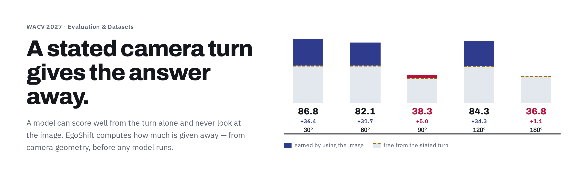
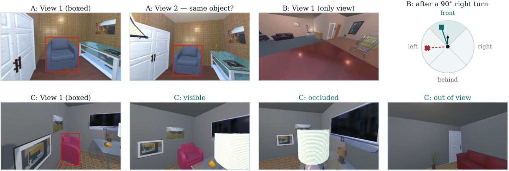
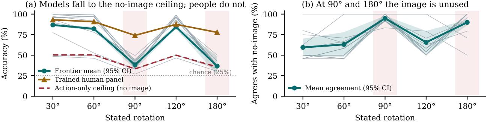
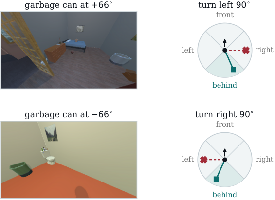

<p align="center">
  
</p>

<h1 align="center">EgoShift</h1>
<p align="center"><i>Bounding the Action-Only Shortcut in Egocentric Spatial Updating for Vision–Language Models</i></p>

<p align="center">
  <a href="https://utsa-virlab.github.io/EgoShift/"><strong>Project Page</strong></a> &nbsp;·&nbsp;
  <a href="assets/EgoShift_WACV2027.pdf"><strong>Paper</strong></a> &nbsp;·&nbsp;
  <a href="#leaderboard"><strong>Leaderboard</strong></a> &nbsp;·&nbsp;
  <a href="https://huggingface.co/datasets/utsavirlab/EgoShift"><strong>Dataset</strong></a> &nbsp;·&nbsp;
  <a href="#installation"><strong>Install</strong></a> &nbsp;·&nbsp;
  <a href="#getting-started"><strong>Getting Started</strong></a>
</p>

<p align="center">
  <a href="https://doi.org/10.5281/zenodo.23440746"></a>
  <a href="https://github.com/UTSA-VIRLab/EgoShift/actions/workflows/ci.yml"></a>
  <a href="https://huggingface.co/datasets/utsavirlab/EgoShift"></a>
  
  <a href="LICENSE"></a>
  
  
</p>

**News: Our paper is accepted at WACV 2027 (Evaluation & Datasets track).**

[Faisal Ahmed](https://www.linkedin.com/in/faisal-ahmed-565943145/), [John Quarles](https://www.linkedin.com/in/johnpquarles/), [Kevin Desai](https://www.linkedin.com/in/kevinpdesai/) — Department of Computer Science, University of Texas at San Antonio

### A stated camera turn gives the answer away

Ask where an object lands after a 90° turn and you have already ruled out some answers. A model can
score well from the turn alone and never look at the image. Balanced answers, text-only arms and
human references miss this, because none of them is conditioned on the action.

EgoShift computes how much the turn gives away — from the camera geometry, **before any model runs** —
and builds every question to sit on that bound. Split a score into the two parts and the failure is
no longer hidden:

| Stated turn | 30° | 60° | 90° | 120° | 180° |
|:---|:---:|:---:|:---:|:---:|:---:|
| Free from the turn | 50.4 | 50.4 | 33.3 | 50.0 | 35.7 |
| **Earned by using the image** | **+36.4** | **+31.7** | **+5.0** | **+34.3** | **+1.1** |
| Frontier mean | 86.8 | 82.1 | 38.3 | 84.3 | 36.8 |

A 120° turn is answered correctly more than twice as often as a 90° one. Accuracy tracks the number
of answers the geometry permits — three at 90° and 180°, two everywhere else — not how far the camera
moved.

<p align="center"></p>

This is not hypothetical. An earlier build of our own data was balanced by the usual standard, and a
predictor that saw **only the stated turn** scored **72.3%** on it.

### Leaderboard

Accuracy (%) on the held-out splits, sorted by **Task B** — the primary task.
Parse failures count as incorrect. 🔵 Google · 🟠 Anthropic · ⚫ OpenAI · ⬜ open weights.

| # | Model | | Task B ↓ | Task A | Task C |
|:--:|:---|:---|--:|--:|--:|
| 🥇 | 🔵 Gemini 3 Pro (thinking) | `██████████░░` | **83.6** | 91.4 | 88.0 |
| 🥈 | 🔵 Gemini 3 Flash | `██████████░░` | **83.5** | 96.6 | 89.3 |
| 🥉 | 🔵 Gemini 3 Pro | `██████████░░` | **81.9** | 91.8 | 88.2 |
| 4 | 🟠 Claude Fable 5 | `██████████░░` | **81.4** | 94.8 | 88.4 |
| 5 | ⚫ GPT-5.6 Sol (thinking) | `██████████░░` | **81.1** | 93.2 | 88.0 |
| 6 | 🟠 Claude Opus 5 (extended) | `██████████░░` | **80.2** | 95.1 | 84.3 |
| 7 | 🟠 Claude Opus 5 | `██████████░░` | **80.1** | 91.6 | 83.2 |
| 8 | 🟠 Claude Sonnet 5 | `█████████░░░` | **77.1** | 92.6 | 75.8 |
| 9 | ⚫ GPT-5.6 Sol | `█████████░░░` | **76.3** | 93.4 | 87.2 |
| 10 | ⬜ InternVL3-38B | `████████░░░░` | **65.1** | 96.1 | 65.2 |
| 11 | ⬜ InternVL3-78B | `███████░░░░░` | **56.1** | 91.9 | 63.6 |
| 12 | 🔵 Gemini 3 Flash Lite | `██████░░░░░░` | **53.0** | 96.2 | 67.3 |
| | 🧑 **Trained human panel** | `██████████░░` | **84.6** | 98.1 | 89.6 |
| | 🚧 *Action-only ceiling* | `██████░░░░░░` | *45.9* | — | — |
| | 🎲 *Random* | `███░░░░░░░░░` | *25.0* | *50.0* | *33.3* |

<details>
<summary><b>All 36 evaluated systems</b> — the remaining 24, same protocol</summary>

| # | Model | | Task B ↓ | Task A | Task C |
|:--:|:---|:---|--:|--:|--:|
|  | ⬜ Qwen3-VL-32B | `██████░░░░░░` | **47.7** | 95.6 | 59.3 |
|  | ⬜ Qwen2.5-VL-32B | `██████░░░░░░` | **46.4** | 80.5 | 59.9 |
|  | ⬜ InternVL3-14B ⚠️ | `█████░░░░░░░` | **45.6** | 92.0 | 63.9 |
|  | ⬜ Qwen2.5-VL-72B ⚠️ | `█████░░░░░░░` | **45.6** | 85.7 | 61.8 |
|  | 🟠 Claude Haiku 4.5 ⚠️ | `█████░░░░░░░` | **45.4** | 71.2 | 38.8 |
|  | ⚫ GPT-5.1 ⚠️ | `█████░░░░░░░` | **42.0** | 90.8 | 73.1 |
|  | ⬜ Qwen3-VL-8B ⚠️ | `█████░░░░░░░` | **41.3** | 92.2 | 63.5 |
|  | ⬜ SenseNova-SI-1.1-Qwen3-VL-8B ⚠️ | `████░░░░░░░░` | **36.9** | 88.8 | 64.2 |
|  | ⬜ SenseNova-SI-1.3-Qwen3-VL-8B ⚠️ | `████░░░░░░░░` | **33.3** | 93.6 | 61.7 |
|  | ⬜ InternVL3-2B ⚠️ | `███░░░░░░░░░` | **28.8** | 53.9 | 39.7 |
|  | ⬜ SenseNova-SI-1.1-Qwen2.5-VL-3B ⚠️ | `███░░░░░░░░░` | **27.9** | 50.0 | 30.8 |
|  | ⬜ InternVL3-8B ⚠️ | `███░░░░░░░░░` | **26.9** | 79.2 | 60.9 |
|  | ⬜ LLaVA-OneVision-7B ⚠️ | `███░░░░░░░░░` | **25.6** | 50.3 | 39.2 |
|  | ⬜ Idefics3-8B ⚠️ | `███░░░░░░░░░` | **24.6** | 59.2 | 37.8 |
|  | ⬜ SenseNova-SI-1.1-Qwen2.5-VL-7B ⚠️ | `███░░░░░░░░░` | **23.9** | 56.8 | 56.2 |
|  | ⬜ Qwen2.5-VL-3B ⚠️ | `███░░░░░░░░░` | **23.3** | 54.4 | 38.7 |
|  | ⬜ EgoMind-7B ⚠️ | `███░░░░░░░░░` | **21.9** | 59.6 | 33.4 |
|  | ⬜ SmolVLM-Instruct ⚠️ | `███░░░░░░░░░` | **21.4** | 51.8 | 33.4 |
|  | ⬜ Molmo2-8B ⚠️ | `███░░░░░░░░░` | **21.3** | 71.1 | 52.0 |
|  | ⬜ LLaVA-1.6-Mistral-7B ⚠️ | `███░░░░░░░░░` | **21.2** | 49.3 | 33.3 |
|  | ⬜ Qwen2-VL-2B ⚠️ | `██░░░░░░░░░░` | **19.1** | 50.3 | 32.9 |
|  | ⬜ Qwen2.5-VL-7B ⚠️ | `██░░░░░░░░░░` | **18.9** | 60.8 | 41.4 |
|  | ⬜ Cosmos-Reason1-7B ⚠️ | `██░░░░░░░░░░` | **15.8** | 76.1 | 41.4 |
|  | ⬜ Qwen2-VL-7B ⚠️ | `█░░░░░░░░░░░` | **11.7** | 50.0 | 62.2 |

⚠️ marks a system **at or below the action-only ceiling** on Task B: its score
is reachable from the stated turn alone, with no image.

</details>

> **22 of the 36 systems we evaluated score at or below the action-only
> ceiling.** For those, the reported accuracy is consistent with never having
> looked at the picture.

**Read the top of that table and the task looks nearly solved** — the best
model is 1.0 point under the human panel. It is not. Read it one turn at a
time instead:

### Why it matters

Across 36 systems, pooled accuracy looks close to solved while a severe failure hides inside it.
Accuracy does **not** fall as the turn grows larger — it collapses at exactly two turns:

| Model | 30° | 60° | 90° | 120° | 180° |
|:---|:---:|:---:|:---:|:---:|:---:|
| Gemini 3 Flash | 100.0 | 99.3 | 🔴 40.6 | 98.9 | 🔴 33.9 |
| Gemini 3 Pro (thinking) | 100.0 | 98.9 | 🔴 41.0 | 98.9 | 🔴 35.7 |
| Claude Fable 5 | 99.3 | 96.7 | 🔴 34.2 | 98.5 | 🔴 37.5 |
| Claude Opus 5 (extended) | 95.6 | 97.8 | 🔴 34.2 | 97.0 | 🔴 33.9 |
| Gemini 3 Pro | 95.9 | 96.7 | 🔴 43.2 | 95.9 | 🔴 37.5 |
| Claude Opus 5 | 95.6 | 97.0 | 🔴 34.6 | 97.0 | 🔴 33.9 |
| GPT-5.6 Sol (thinking) | 97.0 | 91.9 | 🔴 44.0 | 94.8 | 🔴 42.9 |
| Claude Sonnet 5 | 93.3 | 77.8 | 🔴 49.6 | 92.9 | 🔴 35.7 |
| GPT-5.6 Sol | 89.6 | 80.7 | 🔴 44.9 | 91.4 | 🔴 50.0 |
| **Frontier mean** | **86.8** | **82.1** | **38.3** | **84.3** | **36.8** |
| *Action-only ceiling* | *50.4* | *50.4* | *33.3* | *50.0* | *35.7* |
| *Answers the geometry allows* | *2* | *2* | *3* | *2* | *3* |

Every frontier model scores above 89% at 30°, 60° and 120°, and **collapses to
the action-only ceiling at 90° and 180°** — the two turns where the geometry
permits three answers instead of two.

The mechanism shows in one more number. At those two turns, **94.8% and 89.9%**
of frontier answers are *identical to the same model's answer with no image at
all*. The picture is being ignored.

At 90° and 180° no frontier configuration exceeds 50%, and most return the same answer they give
with no image at all. A single pooled number reports progress that has not happened.

<p align="center"></p>

### The benchmark

12,786 held-out questions in simulated indoor scenes, over three tasks. Development and held-out
questions come from **separate rooms**, and all three tasks carry a trained-human reference.

| | A: same object? | B: where after a turn? | C: still visible? |
|:---|:---:|:---:|:---:|
| Role | control | **primary** | supporting |
| Held-out questions | 5,838 | 1,098 | 5,850 |
| Development (public) | 3,582 | 440 | 3,705 |
| Rooms, held out | 3,119 | 736 | 1,334 |
| Object categories | 28 | 45 | 49 |
| Action-only ceiling | — | **45.90%** | — |

Task B's held-out ceiling is `504/1,098 = 45.90%`: the fewest questions the commonest answer can
cover in each of the ten action cells, summed. The build matches it in **every** cell.

### Installation

Python 3.10 or newer. The core package has no simulator dependency — it scores, audits and verifies.

```shell
git clone https://github.com/UTSA-VIRLab/EgoShift.git
cd EgoShift
python -m pip install -e .          # core: no required dependencies
python -m pip install -e ".[test,full]"   # + pytest, numpy, scipy, Pillow
make check
```

Or with conda, pinned:

```shell
conda env create -f environment.yml && conda activate egoshift
python -m pip install -e . -c constraints.txt
```

Regenerating frames additionally needs [AI2-THOR](https://ai2thor.allenai.org/) and the
[`prior`](https://github.com/allenai/prior) package for ProcTHOR-10k houses. Scoring and auditing a
released split do **not** require them. See [`docs/installation.md`](docs/installation.md).

### Getting Started

Score a prediction file against a question file:

```shell
egoshift score \
  --questions   sample/questions.jsonl \
  --predictions sample/predictions.jsonl
```

Run the end-to-end smoke test on the bundled six-item fixture, without installing:

```shell
PYTHONPATH=src python -m egoshift smoke --root sample
PYTHONPATH=src python -m unittest discover -s tests -v
```

Audit Task B's action cells against the analytic geometry support — this is the
ceiling check, and it fails loudly if any cell does not sit on the bound:

```shell
egoshift audit-taskb --questions path/to/taskb_questions.jsonl
```

Validate a dataset manifest: schema, safe relative paths and SHA-256 content hashes.

```shell
egoshift validate-manifest sample/manifest.json --root sample
```

The fixture is schema and scoring smoke data only. It contains no simulator image and is not
evidence for the paper. Full walkthrough: [`docs/getting_started.md`](docs/getting_started.md).

<details>
<summary><b>How the ceiling is computed</b> — the geometry, the formula, and where each piece lives in the code</summary>

Write `z = (r, d)` for the stated turn, `r` its size and `d` its direction. Five sizes and two
directions give ten **cells**. A predictor given `z` and nothing else — no image, no scene, no
object, no wording — can do no better than answering the commonest answer in each cell. With `S(z)`
the answers the geometry allows and `n_z` the questions in cell `z`:

```
C_min = (1/N) · Σ_z  ⌈ n_z / |S(z)| ⌉
```

Two independent implementations compute `S(z)` — an interval derivation and a dense enumeration —
and the build is accepted only when they agree and every cell attains the bound. Balancing answers
*across the whole set* does not achieve this, which is why the earlier 72.3% build looked fine.

| In the paper | In the code |
|:---|:---|
| action-only ceiling and the per-cell check (Sec. 3) | [`taskb_audit.py`](src/egoshift/taskb_audit.py), CLI `egoshift audit-taskb` |
| the answer set `S(z)`, interval derivation | [`support.py`](src/egoshift/support.py) |
| dense non-sharing enumeration verifier | [`taskb_geometry.py`](src/egoshift/taskb_geometry.py) |
| deterministic multiple-choice scoring | [`scoring.py`](src/egoshift/scoring.py) |
| fail-closed split roles, exposure ledger | [`split_roles.py`](src/egoshift/split_roles.py) |
| manifest schema and content addressing | [`manifest.py`](src/egoshift/manifest.py), [`hashing.py`](src/egoshift/hashing.py) |
| integrated construction audit | [`integrated_audit.py`](src/egoshift/integrated_audit.py) |

</details>

### Results

Pooled Task B accuracy puts the best configuration at **83.6%** against a trained-human mean of
**84.6%** — which reads as nearly solved. Read one turn at a time, those two numbers stop matching:
the best model beats the panel at 30°, 60° and 120°, and trails it badly at 90° and 180°.

Because the 180° cell holds only 56 questions, we also report the two hard turns together:
**38.0%** over 290 questions, 95% scene-clustered interval **[32.9, 43.1]**.

<p align="center"></p>

**Progress on EgoShift should appear as higher scores at 90° and 180°.** A system that raises its
pooled score while leaving those at the action-only ceiling has not improved at the thing the
benchmark measures.

### Data

Questions, labels and audit outputs are released under **CC-BY-4.0**. Rendered frames are
redistributed under the upstream **Apache-2.0** terms of AI2-THOR and ProcTHOR-10k, with attribution
and `NOTICE` preserved. **Held-out answers are withheld** so the split stays usable as a test set;
submit predictions to score against them.

**Download:** [`huggingface.co/datasets/utsavirlab/EgoShift`](https://huggingface.co/datasets/utsavirlab/EgoShift) — start with
`egoshift_reviewer_bundle.tar.gz` (169 MB), which reproduces every table in the
paper. See [`docs/data.md`](docs/data.md); the full datasheet is Section F of the
[supplementary material](assets/EgoShift_WACV2027_supplementary.pdf).

<details>
<summary><b>Repository layout</b> — what is in each directory</summary>

| Path | What is in it |
|:---|:---|
| [`src/egoshift/`](src/egoshift) | scoring, geometry, ceiling derivation, split roles |
| [`schemas/`](schemas) | dataset-manifest, prediction and result-record schemas |
| [`tools/`](tools) | model panel runners, bundle builders, audit and anonymity checks |
| [`sample/`](sample) | six-item fixture, dummy predictions, expected metrics |
| [`tests/`](tests) | unit tests; `make check` runs them |
| [`configs/`](configs) | task and panel configurations |
| [`docs/`](docs) | [installation](docs/installation.md), [getting started](docs/getting_started.md), [data](docs/data.md), [FAQ](docs/faq.md) |
| [`assets/`](assets) | paper and supplementary PDFs |

</details>

### Submit your results

The leaderboard takes submissions. Held-out answers are withheld, so scoring
happens here rather than on your machine.

1. Run your system on the held-out questions — they ship in the
   [dataset](https://huggingface.co/datasets/utsavirlab/EgoShift), answers
   excluded.
2. Check your prediction file parses, by scoring it against the **development**
   split first:
   ```shell
   egoshift score --questions dev_questions.jsonl --predictions yours.jsonl --strict
   ```
   `--strict` exits non-zero if anything is missing, extra or unparseable.
3. Open a [results submission](https://github.com/UTSA-VIRLab/EgoShift/issues/new?template=leaderboard.yml)
   issue and attach the file.

We score it and add the row. **Per-turn numbers are required** — a pooled score
cannot be interpreted, which is the finding this benchmark exists to report.

### Citation

The dataset has its own DOI, [`10.5281/zenodo.23440746`](https://doi.org/10.5281/zenodo.23440746), citable independently of the paper.

```bibtex
@inproceedings{ahmed2027egoshift,
  title     = {EgoShift: Bounding the Action-Only Shortcut in Egocentric
               Spatial Updating for Vision--Language Models},
  author    = {Ahmed, Faisal and Quarles, John and Desai, Kevin},
  booktitle = {IEEE/CVF Winter Conference on Applications of Computer Vision (WACV)},
  year      = {2027}
}
```

### License

Code under the licence in [`LICENSE`](LICENSE). Data terms and third-party attribution are in
[`NOTICE`](NOTICE) and [`LICENSE_STATUS.md`](LICENSE_STATUS.md). EgoShift is built on
[AI2-THOR](https://ai2thor.allenai.org/) and [ProcTHOR-10k](https://procthor.allenai.org/),
both Apache-2.0.

### Acknowledgments

Supported by the National Science Foundation. We thank the paid annotators of the San Antonio
Virtual Environments (SAVE) lab for the trained-human reference.
